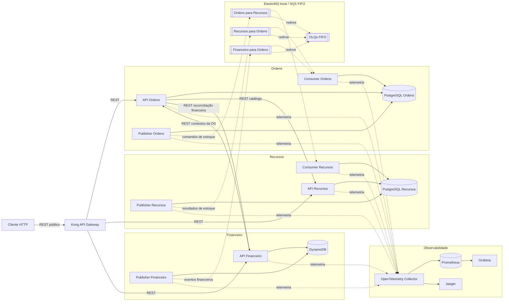

# Diagrama da arquitetura distribuída

As integrações estão rotuladas como REST, mensageria ou telemetria. Comandos e
eventos assíncronos usam setas tracejadas em direção às filas FIFO.

Cada serviço possui persistência exclusiva. As filas oferecem entrega
*at-least-once*; Outbox no produtor e Inbox no consumidor garantem durabilidade e
idempotência dos efeitos.
