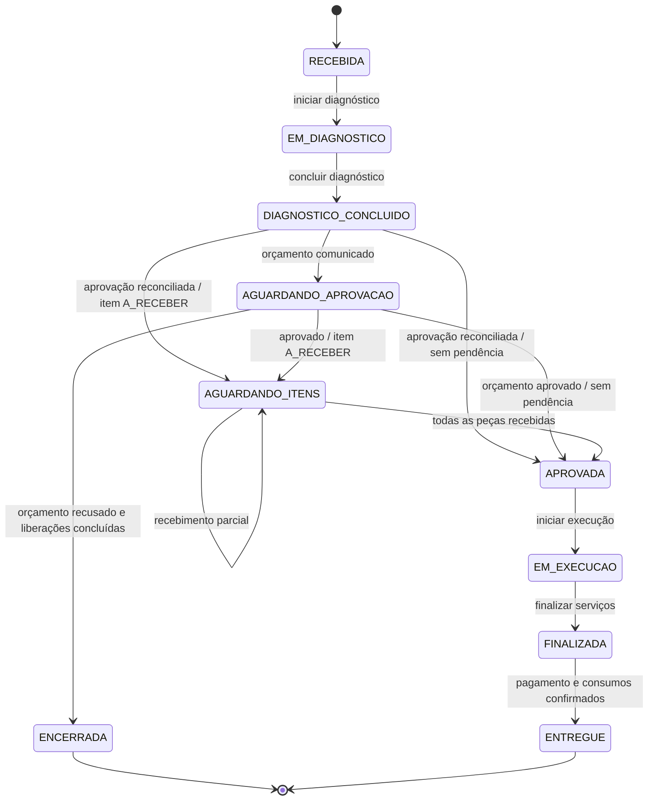

# Diagrama do ciclo de vida da OS

O diagrama reflete a máquina de estados de Ordens. Estados de Saga e de operações de
estoque não são estados públicos da OS.

Na reserva de peça, saldo insuficiente produz item `A_RECEBER`. Isso não compensa a
Saga e não muda imediatamente o estado público da OS. Após a aprovação do orçamento,
a pendência leva a `AGUARDANDO_ITENS`. A recusa do orçamento só chega a
`ENCERRADA` depois de cancelar itens e liberar as reservas necessárias. As duas
transições diretas a partir de `DIAGNOSTICO_CONCLUIDO` cobrem reconciliação ou
entrega fora de ordem do evento de aprovação; eventos repetidos não fazem o estado
regredir.
