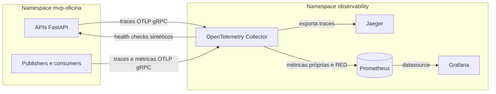

# Diagrama de observabilidade

O Collector centraliza a telemetria e gera métricas RED a partir dos spans. O
Prometheus armazena métricas e alimenta o dashboard do Grafana; o Jaeger permite
consultar traces que atravessam APIs, publicação e consumo de mensagens. Logs não são
exportados e cabeçalhos de autorização não são capturados.
